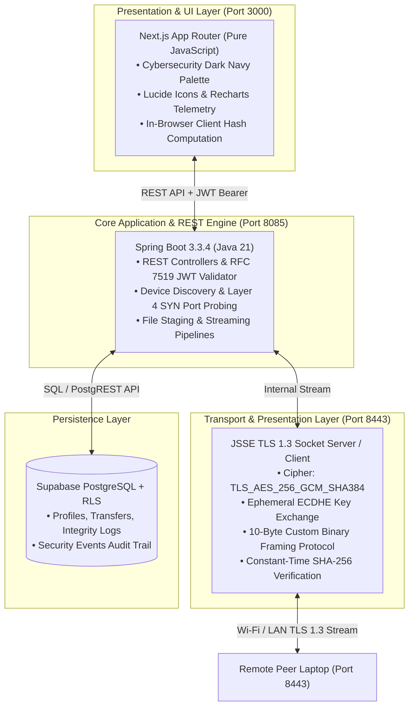

# Secure File Transfer Using Encryption and Integrity Verification
## Data Communication and Networks (DCN) Academic Mini-Project

[](https://openjdk.org/)
[](https://spring.io/projects/spring-boot)
[](https://nextjs.org/)
[](https://tailwindcss.com/)
[](https://supabase.com/)
[](https://tools.ietf.org/html/rfc8446)

---

### Project Overview

**Secure File Transfer Using Encryption and Integrity Verification** is an academic mini-project designed for the **Data Communication and Networks (DCN)** curriculum. It implements a robust, peer-to-peer file transfer system engineered for two laptops communicating across a local Wi-Fi / LAN environment.

The system solves critical network security vulnerabilities found in legacy protocols (e.g., standard FTP, plain HTTP) by combining:
1. **Application-Layer 10-Byte Binary Framing** (`[DCN1][v][type][len]`) to solve TCP stream fragmentation.
2. **Strict Transport Layer Security (TLS 1.3)** with PKCS12 mutual trust, forward secrecy (ECDHE), and AEAD ciphers (`TLS_AES_256_GCM_SHA384`).
3. **FIPS 180-4 SHA-256 Streaming Integrity Verification** computed in $O(1)$ memory buffer chunks with constant-time equality comparisons (`MessageDigest.isEqual()`) to prevent timing attacks.
4. **Optional File-Level AES-256-GCM Envelope Encryption** with 12-byte initialization vectors and 128-bit authentication tags.
5. **Interactive Tampering Simulation Lab** with live Avalanche Effect calculation (~50% bit divergence) and real-time security event telemetry.

---

### System Architecture & OSI Mapping



---

### Custom 10-Byte Binary Protocol Framing

To ensure reliable frame boundary detection across raw TCP streams, every frame begins with a fixed 10-byte header:

```
 0                   1                   2                   3
 0 1 2 3 4 5 6 7 8 9 0 1 2 3 4 5 6 7 8 9 0 1 2 3 4 5 6 7 8 9 0 1
+-+-+-+-+-+-+-+-+-+-+-+-+-+-+-+-+-+-+-+-+-+-+-+-+-+-+-+-+-+-+-+-+
|                       Magic Bytes ("DCN1")                    |
+-+-+-+-+-+-+-+-+-+-+-+-+-+-+-+-+-+-+-+-+-+-+-+-+-+-+-+-+-+-+-+-+
|    Version    |  Message Type |         Payload Length        |
+-+-+-+-+-+-+-+-+-+-+-+-+-+-+-+-+-+-+-+-+-+-+-+-+-+-+-+-+-+-+-+-+
|       (cont. Payload Length)  |      Payload Body (Variable) ...
+-+-+-+-+-+-+-+-+-+-+-+-+-+-+-+-+-+-+-+-+-+-+-+-+-+-+-+-+-+-+-+-+
```

| Header Offset | Field Name | Type | Value / Purpose |
| :---: | :--- | :--- | :--- |
| **0 – 3** | Magic Bytes | 4-byte ASCII | `0x44 0x43 0x4E 0x31` (`"DCN1"`) |
| **4** | Version | 1-byte unsigned | `0x01` |
| **5** | Message Type | 1-byte enum | `0x01` Metadata Req, `0x02` Metadata Ack, `0x03` Chunk Data, `0x04` Chunk Ack, `0x05` Complete, `0x06` Verified, `0x07` Failed |
| **6 – 9** | Payload Length | 4-byte big-endian int | 0 to 65,544 bytes |
| **10+** | Payload | Byte array | Serialized JSON metadata or 64 KB chunk data |

---

### Project Directory Structure

```
d:\DCN\secure-file-transfer\
│
├── backend/                                   # Java 21 / Spring Boot 3 Engine
│   ├── src/main/java/com/dcn/securefiletransfer/
│   │   ├── controller/                        # REST Endpoints (Transfers, Devices, Integrity, Tampering)
│   │   ├── model/                             # Entities (Transfer, Device, IntegrityCheck, SecurityEvent)
│   │   ├── network/
│   │   │   ├── client/                        # TlsFileClient, TcpFileClient (10-byte framing)
│   │   │   ├── server/                        # TlsFileServer, TcpFileServer (Port 8443)
│   │   │   ├── protocol/                      # FramingUtil, Frame, TransferMetadata, ProtocolConstants
│   │   │   └── test/                          # Academic15PointTestSuite.java
│   │   ├── security/
│   │   │   ├── crypto/                        # SHA256Util (O(1) streaming), AesGcmUtil (GCM-256)
│   │   │   ├── jwt/                           # JwtUtil (RFC 7519 validation)
│   │   │   └── tls/                           # TlsContextFactory, TlsSessionDetails (JSSE TLS 1.3)
│   │   └── service/                           # TransferService, DeviceService, IntegrityService
│   ├── src/main/resources/
│   │   ├── application.properties             # Spring & Supabase configuration
│   │   ├── server-keystore.p12                # PKCS12 server TLS certificate
│   │   └── client-truststore.p12              # PKCS12 trusted root truststore
│   └── pom.xml                                # Maven build descriptors
│
├── frontend/                                  # Next.js 14 Web UI (Pure JavaScript)
│   ├── app/
│   │   ├── page.jsx                           # Landing Page & Feature Overview
│   │   ├── dashboard/page.jsx                 # Device Manager & System Overview
│   │   ├── send/page.jsx                      # File Upload, Client SHA-256 & Transfer
│   │   ├── receive/page.jsx                   # Received Files & Download Manager
│   │   ├── history/page.jsx                   # Audited Transfer Logs & Filters
│   │   ├── integrity/page.jsx                 # SHA-256 Verification Records
│   │   ├── tampering-lab/page.jsx             # Case A vs Case B Avalanche Simulator
│   │   ├── security/page.jsx                  # Security Operations Center & Telemetry
│   │   ├── analytics/page.jsx                 # Recharts Bandwidth & Success Rate Charts
│   │   └── settings/page.jsx                  # Protocol & Keystore Configuration
│   ├── components/                            # AppShell, Navigation, Alerts
│   └── package.json                           # Dependencies (Tailwind, Lucide, Recharts)
│
├── documentation/
│   ├── PROJECT_REPORT.md                      # Complete Academic Mini-Project Report
│   ├── TWO_LAPTOP_DEPLOYMENT_GUIDE.md         # Field Manual for 2 Laptops over Wi-Fi
│   └── VIVA_QUESTIONS_AND_ANSWERS.md          # Top 25 DCN Viva Questions & Answers
│
└── schema.sql                                 # Supabase PostgreSQL Schema & RLS Policies
```

---

### Quick Start Guide

#### 1. Start the Backend Engine
```powershell
cd backend
mvn spring-boot:run
```
*Port Allocations*:
- REST API: `http://localhost:8085`
- TLS 1.3 Socket Server: `port 8443`

#### 2. Start the Frontend Application
```powershell
cd frontend
npm run start
# Or 'npm run dev'
```
*Access UI*: `http://localhost:3000`

#### 3. Run the 15-Point Academic Test Suite
```powershell
cd backend
mvn compile "-Dexec.mainClass=com.dcn.securefiletransfer.network.test.Academic15PointTestSuite" exec:java
```
*Output*:
```
================================================================================
     DCN ACADEMIC MINI-PROJECT: 15-POINT COMPREHENSIVE TEST SUITE               
     Title: Secure File Transfer Using Encryption and Integrity Verification     
================================================================================

[TEST 01/15] TC-01: Multi-Format File Streaming (PDF, PNG, TXT, ZIP)... PASSED
[TEST 02/15] TC-02: Large Chunked Streaming Buffer (64 KB Chunks)... PASSED
[TEST 03/15] TC-03: Single-Bit File Tampering Detection (Avalanche Effect)... PASSED
[TEST 04/15] TC-04: Byte Injection / Malicious Truncation Detection... PASSED
[TEST 05/15] TC-05: Strict TLS 1.3 Handshake & AEAD Cipher Enforcement... PASSED
[TEST 06/15] TC-06: AES-256-GCM Ephemeral File Encryption & Decryption... PASSED
[TEST 07/15] TC-07: RFC 7519 JSON Web Token (JWT) Parsing & Expiry Check... PASSED
[TEST 08/15] TC-08: Transfer Record Isolation & Search Filtering... PASSED
[TEST 09/15] TC-09: Untrusted Certificate Verification (Negative Security)... PASSED
[TEST 10/15] TC-10: Offline Target Peer Graceful Failure (Timeout Handling)... PASSED
[TEST 11/15] TC-11: Transfer Cancellation & State Reset... PASSED
[TEST 12/15] TC-12: Filename Path Traversal Sanitization... PASSED
[TEST 13/15] TC-13: Device Registration & Layer 4 SYN Reachability Probe... PASSED
[TEST 14/15] TC-14: Tampering Simulation Lab (Case A Control vs Case B Tamper)... PASSED
[TEST 15/15] TC-15: Analytics KPI Aggregation & Security Posture... PASSED

================================================================================
  15-POINT TEST SUITE EXECUTION SUMMARY: 15 / 15 TESTS PASSED (100% SUCCESS) 
================================================================================
```

---

### Two-Laptop Wi-Fi Demonstration

For field deployment between two separate student laptops across local Wi-Fi or a Mobile Hotspot, see the complete guide:
👉 **[Two-Laptop Wi-Fi Deployment Guide](file:///d:/DCN/secure-file-transfer/documentation/TWO_LAPTOP_DEPLOYMENT_GUIDE.md)**

For viva voce examination preparation:
👉 **[Top 25 DCN Viva Questions & Answers](file:///d:/DCN/secure-file-transfer/documentation/VIVA_QUESTIONS_AND_ANSWERS.md)**

For the full academic report with DFDs and UML diagrams:
👉 **[Academic Project Report](file:///d:/DCN/secure-file-transfer/documentation/PROJECT_REPORT.md)**
